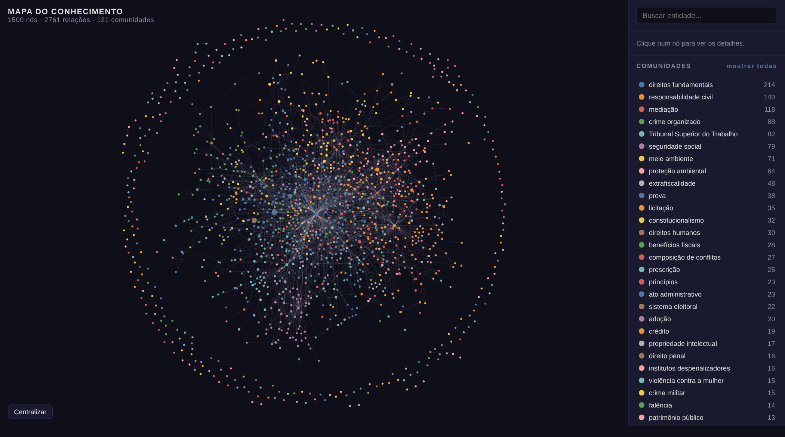
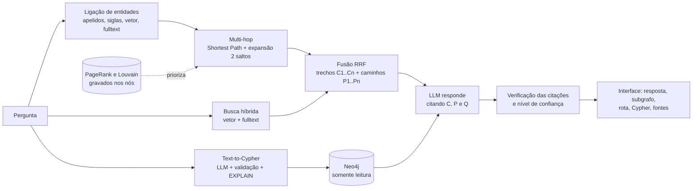
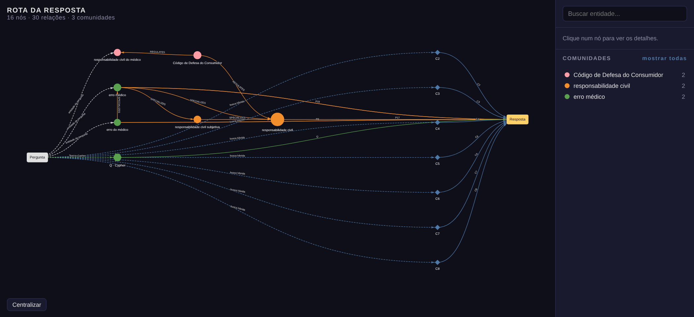
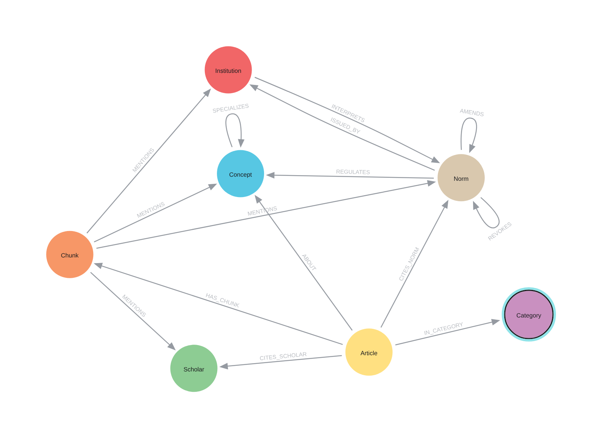
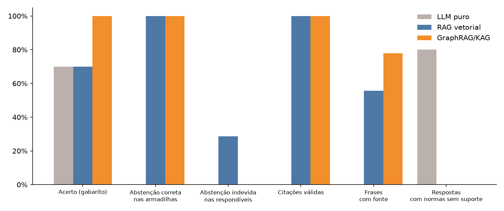
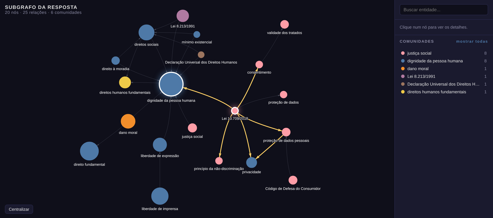

# GraphRAG Jurídico – Perguntas sobre Direito com Grafo de Conhecimento e LLM

[](https://github.com/MaraLeao/GraphRAG-KAG-juridico/actions/workflows/ci.yml)
[](https://www.python.org/)
[](https://docs.astral.sh/uv/)
[](https://neo4j.com/)
[](https://streamlit.io/)
[](https://huggingface.co/BAAI/bge-m3)
[](https://openrouter.ai/)

GraphRAG Jurídico responde perguntas sobre ~1.000 artigos do Âmbito Jurídico combinando um grafo de conhecimento no Neo4j com um LLM: a resposta cita os trechos dos artigos e os caminhos do grafo que a sustentam, e o sistema se abstém quando o corpus não tem a informação.

| <div align="center">Mapa do conhecimento: as 1.500 entidades mais centrais do grafo (PageRank), coloridas pelas comunidades que o Louvain encontrou sem supervisão, que correspondem às áreas do Direito</div> |
|---|
|  |

## Visão Geral

Este repositório é o projeto final da disciplina *Tendências em Ciência da Computação* (Bacharelado em Ciência da Computação, 2026): um sistema de **GraphRAG/KAG** (*Graph-* e *Knowledge-Augmented Generation*) que cobre os quatro pilares da especificação: extração de entidades e relações do texto (Text-to-Graph), modelagem LPG no Neo4j, recuperação híbrida com travessia multi-hop e uma interface que mostra o subgrafo e a procedência de cada resposta. Uma avaliação contra o LLM puro e contra o RAG só vetorial mede o efeito do grafo.

---

## O Problema

Perguntas jurídicas exigem precisão e fonte, e é aí que os LLMs e o RAG tradicional falham:

| Dificuldade | Consequência |
|---|---|
| O LLM responde de memória, sem fonte | Cita leis que não pode comprovar; na nossa avaliação, 80% das respostas do LLM puro citam normas sem nenhum suporte |
| O RAG vetorial só acha trechos parecidos com a pergunta | Perde relações entre entidades ("quais instituições interpretam normas que regulam o consentimento?") e se abstém em perguntas que têm resposta |
| A resposta é um texto fechado | Não dá para saber de onde veio cada afirmação nem conferir o raciocínio |

---

## A Solução

1. **Text-to-Graph** -> um LLM extrai normas, instituições, conceitos e doutrinadores de cada trecho, sempre com o trecho literal de evidência; a resolução de entidades unifica "LGPD", "Lei Geral de Proteção de Dados" e "Lei 13.709/2018" num nó só.
2. **Grafo LPG no Neo4j** -> 29.705 nós e 111.547 relações, com constraints de unicidade e índices BTree, fulltext e vetoriais (bge-m3, 1024 dimensões).
3. **Algoritmos de grafo** -> PageRank (centralidade) e Louvain (comunidades) calculados em Python e gravados nos nós; Shortest Path calculado na hora da pergunta.
4. **Recuperação híbrida multi-hop** -> liga as entidades da pergunta, busca caminhos entre elas (até 4 saltos), expande 2 saltos priorizando a mesma comunidade e o maior PageRank, e funde por RRF os trechos dos caminhos, das entidades, da busca vetorial e da fulltext.
5. **Text-to-Cypher** -> o LLM também escreve uma consulta Cypher, validada (somente leitura, schema, limite de saltos e de linhas) e conferida com `EXPLAIN` antes de executar.
6. **Resposta fundamentada** -> o LLM recebe só esse contexto, cita cada afirmação (`[C2]` trecho, `[P1]` caminho, `[Q]` consulta) ou diz que não há informação; as citações são conferidas e compõem o nível de confiança.

---

## Fluxo da Aplicação



| <div align="center">Rota da resposta para "Como a responsabilidade civil se aplica ao erro médico?": pergunta, entidades, nós percorridos nos caminhos citados, trechos e consulta, até a resposta</div> |
|---|
|  |

---

## Dados

O corpus é o dataset público [`celsowm/ambito_juridico_artigos`](https://huggingface.co/datasets/celsowm/ambito_juridico_artigos) (Hugging Face): 11.373 artigos do Âmbito Jurídico em 17 áreas do Direito. A análise exploratória (`analise_ambito_juridico.ipynb`) remove duplicatas (restam ~10,6 mil artigos) e sorteia um subconjunto estratificado por categoria.

| Elemento do grafo | Quantidade |
|---|---:|
| Artigos / trechos (`Chunk`) | 1.062 / 14.048 |
| Conceitos / normas / doutrinadores / instituições | 8.081 / 2.692 / 2.688 / 1.117 |
| Menções com evidência literal (`MENTIONS`) | 54.021 |
| Relações entre entidades (`REGULATES`, `SPECIALIZES`, `INTERPRETS`...) | 12.304 |
| Comunidades Louvain | 367 |

O modelo completo (labels, propriedades, relações, constraints, índices, decisões e limitações) está em [`docs/schema_lpg.md`](./docs/schema_lpg.md).

| <div align="center">Schema LPG exportado do Neo4j Aura</div> |
|---|
|  |

> [!NOTE]
> A licença do dataset não está declarada no Hugging Face. Os trechos gravados neste repositório (modo demonstração e
> avaliação) são cortados em 700 caracteres e sempre trazem o link do artigo original.

---

## Resultados

### GraphRAG/KAG x RAG vetorial x LLM puro

Dez perguntas com gabarito (estruturadas, multi-hop e três armadilhas que o corpus não responde, inclusive uma lei inexistente), o mesmo LLM nos três métodos e métricas automáticas, sem LLM juiz:

| Métrica | LLM puro | RAG vetorial | **GraphRAG/KAG** |
|---|:---:|:---:|:---:|
| Acerto (gabarito) | 70% | 70% | **100%** |
| Abstenção correta nas armadilhas | 0% | 100% | **100%** |
| Abstenção indevida nas respondíveis (menor é melhor) | 0% | 29% | **0%** |
| Citações válidas | 0% | 100% | **100%** |
| Frases com fonte | 0% | 56% | **78%** |
| Respostas com normas sem suporte (menor é melhor) | 80% | 0% | **0%** |
| Latência mediana | 6,3 s | 10,2 s | 17,5 s |

O RAG vetorial é seguro, mas se absteve em perguntas que tinham resposta (os trechos certos não eram os mais parecidos com a pergunta); o grafo os encontrou pelas entidades e pelos caminhos. O LLM puro acerta boa parte de memória, mas nunca se abstém e cita leis que nada no sistema sustenta. Detalhes por pergunta em [`evaluation/report.md`](./evaluation/report.md).

| <div align="center">Métricas por método (gerado por `graphrag_juridico.evaluation report`)</div> |
|---|
|  |

### Algoritmos de grafo e componentes

* **Louvain:** as maiores comunidades recuperam as áreas do Direito **sem supervisão** (direitos fundamentais, responsabilidade civil, mediação, crime organizado, trabalho, seguridade social, meio ambiente...).
* **PageRank + Louvain na expansão:** na pergunta sobre a LGPD, sem os algoritmos a expansão só traz vizinhos diretos; só com PageRank, puxa conceitos centrais de outros temas (CLT, dano moral); com os dois, traz caminhos de 2 saltos no tema (proteção de dados, privacidade, consentimento).
* **Text-to-Cypher:** acertou as 3 consultas de referência (7, 1 e 13 resultados) e devolveu 0 linhas na pergunta armadilha.
* **Ligação de entidades:** "LGPD", siglas como "STF" e números como "Lei nº 13.709/2018" chegam ao nó canônico, o que resolveu o caso em que a busca só por trechos não trazia nada sobre a LGPD.

---

## Funcionalidades

* **Resposta com procedência:** citações destacadas por tipo (trecho, caminho do grafo, consulta), aviso de abstenção e nível de confiança com seus componentes (similaridade vetorial, concordância fulltext, cobertura de caminhos, citações válidas).
* **Três visões do grafo** em vis-network, com fundo escuro, layout ForceAtlas2, cor pela comunidade (Louvain) e tamanho pelo PageRank:
  * **subgrafo da resposta**, com as entidades da pergunta em destaque e os caminhos citados em amarelo;
  * **rota da resposta**, da pergunta à resposta, só com o que foi citado;
  * **mapa do conhecimento**, com as 1.500 entidades mais centrais, busca, filtro por comunidade e vizinhos do nó clicado.
* **Rastreabilidade:** trechos com link para o artigo, caminhos em lista, Cypher executada com o resultado da `[Q]`, nós consultados e o JSON completo.
* **Algoritmos ligáveis:** Shortest Path, PageRank, Louvain e a Cypher do LLM podem ser desligados para comparar o efeito de cada um.
* **Comparação ao vivo:** a mesma pergunta respondida pelo LLM puro, pelo RAG vetorial e pelo GraphRAG, lado a lado, com as métricas automáticas e uma legenda das siglas das leis.
* **Modo demonstração:** reproduz execuções reais gravadas, sem banco nem LLM, para apresentar sem internet ou sem cota.
* **Chave reserva do LLM:** se a cota da chave principal acaba (429/402), as chamadas passam para a `FALLBACK_OPENROUTER_KEY`.

---

## Demonstração

| <div align="center">Subgrafo da resposta para "Qual a relação entre a LGPD e a dignidade da pessoa humana?": entidades da pergunta em destaque e caminhos citados em amarelo</div> |
|---|
|  |

---

## Requisitos da Especificação

| Pilar | Requisito | Onde está |
|---|---|---|
| Text-to-Graph | NER/RE automatizado | `scripts/extract_pilot.py` (LLM com evidência literal validada) |
| | Resolução de entidades | `scripts/resolve_entities.py` (chaves canônicas) |
| | Esquema orientado ao domínio | `scripts/extraction_schema.py`, [`docs/schema_lpg.md`](./docs/schema_lpg.md) |
| Neo4j LPG | Labels, relações e propriedades | [`docs/schema_lpg.md`](./docs/schema_lpg.md) |
| | Constraints e índices BTree, fulltext e vetoriais | `schema.cypher`, `schema_vector.cypher` |
| Recuperação | Busca híbrida (vetor + Cypher) | `retrieval.py`, `text_to_cypher.py` |
| | Multi-hop (2+ saltos) | `multihop.py` |
| | PageRank, Louvain e Shortest Path | `algorithms.py`, `multihop.py` |
| | Mitigação de alucinação comprovada | `ask.py` (citações e abstenção), `metrics.py`, `evaluation.py`, [`evaluation/report.md`](./evaluation/report.md) |
| Interface | UI funcional | `app/streamlit_app.py` |
| | Subgrafo interativo | `graph_view.py` |
| | Nós consultados, Cypher gerada, confiança | abas da interface e contrato `AskResult` (`contracts.py`) |
| Qualidade | Testes e CI | `tests/` (151 testes), `.github/workflows/ci.yml` |

---

## Estrutura do Projeto

```
GraphRAG-KAG-juridico/
├── src/graphrag_juridico/        # Pacote: o sistema de perguntas
│   ├── config.py                 # .env, driver Neo4j, chamadas ao LLM com chave reserva
│   ├── db.py                     # read() em transação somente leitura; write() só para manutenção
│   ├── contracts.py              # AskResult: o contrato entre recuperação, interface e avaliação
│   ├── entities.py               # Ligação das entidades da pergunta
│   ├── retrieval.py              # Busca híbrida de trechos (vetor + fulltext + entidades, RRF)
│   ├── algorithms.py             # PageRank e Louvain (networkx)
│   ├── multihop.py               # Shortest Path, expansão 2 saltos, subgrafo e confiança
│   ├── text_to_cypher.py         # Cypher gerada pelo LLM e validada
│   ├── ask.py                    # Orquestrador: resposta com citações verificadas
│   ├── baselines.py              # LLM puro e RAG vetorial (comparação)
│   ├── metrics.py                # Métricas automáticas de uma resposta
│   ├── evaluation.py             # Avaliação comparativa, relatório e gráfico
│   ├── graph_view.py             # Visualizações vis-network (mapa, subgrafo, rota)
│   ├── mock.py                   # Modo demonstração (execuções gravadas)
│   └── resources/                # Respostas gravadas e perguntas da avaliação
├── app/streamlit_app.py          # Interface (camada fina sobre o pacote)
├── scripts/                      # Pipeline de ingestão: chunking, NER/RE, resolução, carga, embeddings
├── tests/                        # Testes (rodam sem Neo4j e sem LLM)
├── evaluation/                   # Relatório e gráfico da avaliação
├── docs/                         # Schema LPG e figuras
├── schema.cypher                 # Constraints, índice BTree e índices fulltext
├── schema_vector.cypher          # Índices vetoriais
├── docker-compose.yml            # Neo4j local, restauração e geração de dump
├── analise_ambito_juridico.ipynb # Análise exploratória e amostragem do dataset
├── pyproject.toml / uv.lock      # Dependências (uv)
└── .github/workflows/ci.yml      # CI: gitleaks, ruff e pytest
```

---

## Instalação e Execução

### 1. Pré-requisitos

* Linux, macOS ou Windows com WSL2, e Git
* [uv](https://docs.astral.sh/uv/getting-started/installation/) (baixa o Python 3.12 sozinho)
* Um Neo4j com os dados: o **Neo4j Aura** do grupo (credenciais por mensagem privada) **ou** Docker para o banco local a partir do dump
* Uma chave do [OpenRouter](https://openrouter.ai/) (o plano gratuito permite 50 requisições por dia por conta); não é necessária no modo demonstração

### 2. Clonar o repositório e sincronizar o ambiente

```bash
git clone https://github.com/MaraLeao/GraphRAG-KAG-juridico.git
cd GraphRAG-KAG-juridico

uv sync --extra embeddings   # dependências + PyTorch e o bge-m3 (busca vetorial local)
```

> O extra `embeddings` é necessário para perguntar no modo real (a pergunta é embutida localmente com o bge-m3,
> ~2 GB baixados na primeira pergunta). Só para o modo demonstração, testes e CI basta `uv sync`.
> Para um PyTorch só de CPU: `uv pip install torch --index-url https://download.pytorch.org/whl/cpu`.

### 3. Variáveis de ambiente

```bash
cp .env.example .env
```

| Variável | Para quê |
|---|---|
| `NEO4J_URI`, `NEO4J_USER`, `NEO4J_PASSWORD` | Banco usado pelo sistema (Aura por padrão; no Aura o usuário é o ID da instância) |
| `NEO4J_LOCAL_PASSWORD` | Senha do Neo4j local criado pelo `docker-compose.yml` |
| `OPENROUTER_KEY` | Chave do LLM |
| `FALLBACK_OPENROUTER_KEY` | Opcional: chave de outra conta, usada quando a principal esgota a cota |
| `CYPHER_MODEL`, `ANSWER_MODEL` | Modelos do OpenRouter para a Cypher e para a resposta |

O `.env` nunca vai para o Git; o CI procura segredos em todo PR (gitleaks).

### 4. Banco de dados

**Opção A: Neo4j Aura (compartilhado).** Preencha o bloco do Aura no `.env`. O banco já tem os dados, os índices e o PageRank/Louvain gravados.

**Opção B: Neo4j local a partir do dump.** Baixe o `neo4j.dump` (347 MB, com PageRank e comunidades) da
[pasta do dump no Google Drive](https://drive.google.com/drive/folders/1XbVeD5a3LNzb3W-_x-oAxjnMumq2ujRY?usp=sharing)
e coloque em `dump/`:

```bash
docker compose run --rm restore    # restaura dump/neo4j.dump no volume (Neo4j parado)
docker compose up -d neo4j         # Browser em http://localhost:7474
```

No `.env`, comente o bloco do Aura e descomente o bloco local. Para gerar um dump novo do banco local:
`chmod a+w dump` (uma vez) e `docker compose stop neo4j && docker compose run --rm dump && docker compose up -d neo4j`.

### 5. Rodar a interface

```bash
uv run streamlit run app/streamlit_app.py                  # http://localhost:8501
GRAPHRAG_MOCK=1 uv run streamlit run app/streamlit_app.py  # modo demonstração: sem banco e sem LLM
```

### 6. Testes e lint

```bash
uv run pytest                      # 151 testes, sem Neo4j e sem LLM
uv run ruff check src/ tests/ app/
```

É o mesmo que o CI roda em todo PR. Para adicionar uma dependência: `uv add <pacote>` (ou `uv add --dev <pacote>`) e
commite o `pyproject.toml` **e** o `uv.lock`; `uv sync --locked` confere se o lock está em dia.

---

## Como Usar

Na interface, digite a pergunta e tecle **Enter** (ou clique num exemplo). Mudar as opções da barra lateral não refaz a pergunta, para não gastar a cota. Cada pergunta usa 2 a 3 requisições ao LLM (4 a 5 com a comparação ligada); repetidas vêm do cache.

Cada etapa também roda pela linha de comando:

| Comando | O que faz | LLM |
|---|---|:---:|
| `uv run python -m graphrag_juridico.ask "pergunta"` | Pipeline completo: resposta citada, fontes e confiança (`--no-cypher` economiza uma requisição) | 2 a 3 |
| `uv run python -m graphrag_juridico.multihop "pergunta"` | Só a recuperação: entidades, caminhos, trechos e confiança (`--no-pagerank`, `--no-communities`, `--no-shortest-path`) | não |
| `uv run python -m graphrag_juridico.text_to_cypher "pergunta"` | Gera, valida e executa a Cypher | 1 a 2 |
| `uv run python -m graphrag_juridico.algorithms` | PageRank e Louvain: entidades mais centrais e maiores comunidades (`--write` grava no banco) | não |
| `uv run python -m graphrag_juridico.evaluation run` | Avaliação: roda o que falta e grava cada resposta (retoma se a cota acabar) | ~45 |
| `uv run python -m graphrag_juridico.evaluation report` | Gera `evaluation/report.md` e `metrics.png` a partir das respostas gravadas | não |
| `uv run python -m graphrag_juridico.mock --record` | Regrava as execuções do modo demonstração | 2 a 3 por pergunta |

```python
from graphrag_juridico.ask import ask
from graphrag_juridico.multihop import Options

result = ask("Quais instituições interpretam a LGPD?", options=Options(use_pagerank=False))
result.answer, result.chunks, result.paths, result.cypher, result.cypher_rows, result.confidence
```

> [!WARNING]
> `algorithms --write` grava no banco configurado no `.env`. No Aura, que é compartilhado, combine com o grupo e
> teste antes no Neo4j local.

### Reconstruir o grafo do zero

O dump evita refazer a extração (que usa o LLM em milhares de trechos). Para reconstruir, na ordem:

1. `analise_ambito_juridico.ipynb`: baixa o dataset e gera o subconjunto (`.parquet`).
2. `uv run python scripts/apply_schema.py schema.cypher`: constraints e índices.
3. `uv run python scripts/load_structure.py`: artigos, categorias e trechos.
4. `uv run python scripts/extract_pilot.py`: NER/RE por LLM (`EXTRACTION_MODEL`), gera um `.jsonl`.
5. `uv run python scripts/load_entities.py <arquivo.jsonl>`: resolução de entidades e carga (`--dry-run` mostra as estatísticas).
6. `uv run python scripts/embed.py --local` e `uv run python scripts/apply_schema.py schema_vector.cypher`: embeddings e índices vetoriais.
7. `uv run python -m graphrag_juridico.algorithms --write`: PageRank e Louvain.

---

## Segurança

* Chaves e senhas ficam só no `.env`, ignorado pelo Git; o CI barra segredos com o gitleaks.
* Toda consulta do sistema roda em transação **somente leitura**: mesmo uma Cypher maliciosa gerada pelo LLM é recusada pelo Neo4j. A escrita (`db.write`) existe só para rotinas de manutenção.
* Não exponha a porta 7687 do Neo4j na internet; para compartilhar o banco, use um usuário somente leitura.

---

## Créditos e Referências

* Dataset: [celsowm/ambito_juridico_artigos](https://huggingface.co/datasets/celsowm/ambito_juridico_artigos) (artigos do [Âmbito Jurídico](https://ambitojuridico.com.br/)).
* Modelo de embedding [BAAI/bge-m3](https://huggingface.co/BAAI/bge-m3) via `sentence-transformers`; LLMs via [OpenRouter](https://openrouter.ai/).
* Visual dos grafos inspirado no [Graphify](https://github.com/Graphify-Labs/graphify) (Apache-2.0); nenhum código copiado.

---

## Autores

<div align="center">
  <table>
    <tr>
      <td align="center">
        <a href="https://github.com/MaraLeao">
          <br />
          <sub><b>Maria Clara Gouveia</b></sub>
        </a>
      </td>
      <td align="center">
        <a href="https://github.com/PLeonLopes">
          <br />
          <sub><b>Pedro Nícollas Leon Pereira Lopes</b></sub>
        </a>
      </td>
      <td align="center">
        <a href="https://github.com/irlvinicius">
          <br />
          <sub><b>Vinícius Vieira de Lima</b></sub>
        </a>
      </td>
    </tr>
    <tr>
      <td align="center">
        <a href="https://github.com/Gabril64">
          <br />
          <sub><b>Gabriel Guberson de Oliveira Alves</b></sub>
        </a>
      </td>
      <td align="center">
        <a href="https://github.com/Rick-SF">
          <br />
          <sub><b>Ricardo Silva Flores</b></sub>
        </a>
      </td>
      <td align="center">
        <a href="https://github.com/eduardoramalhoz">
          <br />
          <sub><b>Eduardo Ramalho de Oliveira</b></sub>
        </a>
      </td>
    </tr>
  </table>
</div>

<p align="center">
  <sub>Tendências em Ciência da Computação | Bacharelado em Ciência da Computação | Prof. Ricardo Roberto de Lima | 2026</sub>
</p>
