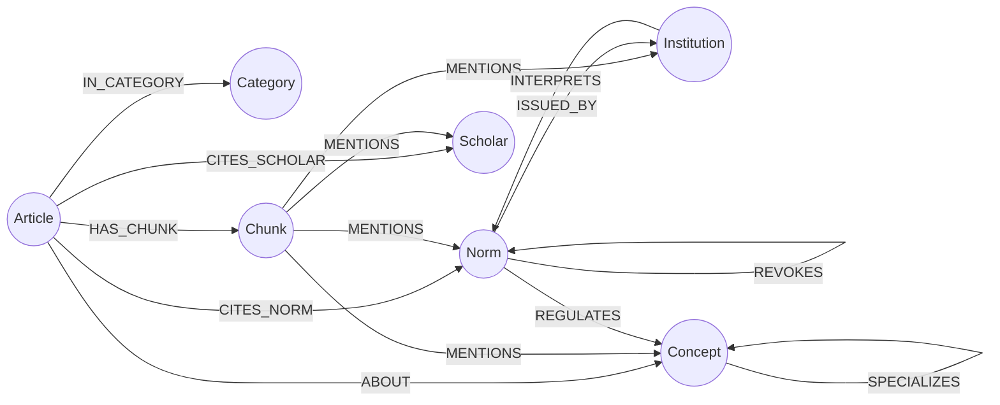

# Modelagem do Grafo de Conhecimento Jurídico (LPG)

Este documento descreve o modelo **Labeled Property Graph (LPG)** implementado no Neo4j para o sistema GraphRAG/KAG sobre artigos jurídicos. Ele cobre os nós, relações, constraints e índices definidos em `schema.cypher` e `schema_vector.cypher`.



## 1. Visão Geral

O grafo representa o conhecimento extraído de ~1.000 artigos do [Âmbito Jurídico](https://huggingface.co/datasets/celsowm/ambito_juridico_artigos) em 17 áreas do Direito. A modelagem conecta trechos de texto (`Chunk`) a entidades jurídicas (`Norm`, `Institution`, `Concept`, `Scholar`), permitindo tanto busca semântica por embedding quanto travessia estruturada via Cypher.

Nomes de labels e tipos de relação estão em inglês; valores e conteúdo em português.

**Estatísticas do banco (snapshot de 14/11, Neo4j Aura):**

| Métrica | Valor |
|---|---|
| Total de nós | 29.705 |
| Total de relações | 111.547 |
| Chunks com embedding | 14.048 (100%) |
| Concepts com embedding | 8.081 (100%) |
| Entidades com `pagerank`/`community` | 8.176 (`Norm`, `Concept`, `Institution`) |
| Comunidades Louvain | 367 |
| Constraints | 7 |

| Label | Nós | | Relação | Relações |
|---|---:|---|---|---:|
| `Chunk` | 14.048 | | `MENTIONS` | 54.021 |
| `Concept` | 8.081 | | `ABOUT` | 17.777 |
| `Norm` | 2.692 | | `HAS_CHUNK` | 14.048 |
| `Scholar` | 2.688 | | `CITES_NORM` | 6.911 |
| `Institution` | 1.117 | | `REGULATES` | 6.673 |
| `Article` | 1.062 | | `CITES_SCHOLAR` | 5.424 |
| `Category` | 17 | | `SPECIALIZES` | 3.961 |
| | | | `IN_CATEGORY` | 1.062 |
| | | | `INTERPRETS` / `ISSUED_BY` | 667 / 646 |
| | | | `AMENDS` / `REVOKES` | 300 / 57 |

---

## 2. Nós (Labels)

| Label | Constraint de Unicidade | Propriedades Principais | Descrição |
|---|---|---|---|
| `Article` | `article_id` → `id` | `id`, `title`, `summary`, `link`, `word_count` | Artigo jurídico completo do dataset. Ponto de entrada do grafo. A área do Direito não é propriedade: é a relação `IN_CATEGORY`. |
| `Chunk` | `chunk_id` → `id` | `id`, `text`, `order`, `section`, `embedding` (1024 dim) | Trecho de texto de um artigo, unidade básica de recuperação. `order` é a posição no artigo e `section` o título da seção (presente em 44% dos trechos). Contém o embedding vetorial usado na busca semântica. |
| `Category` | `cat_name` → `name` | `name` | Área do Direito (ex: Direito Penal, Direito do Trabalho). Agrupa artigos por domínio. |
| `Norm` | `norm_id` → `id` | `id`, `name`, `type`, `number`, `year`, `pagerank`, `community` | Lei, decreto, súmula, código ou outro ato normativo. O `id` é canônico (`tipo:número:ano`), gerado na resolução de entidades: a LGPD é `lei:13709:2018` (`name` = "Lei 13.709/2018") e a Constituição Federal é `const:1988`. |
| `Institution` | `inst_name` → `name` | `name`, `acronym`, `pagerank`, `community` | Órgão, tribunal ou entidade jurídica (ex: "Supremo Tribunal Federal", `acronym` = "STF"). A sigla existe em 733 das 1.117 instituições. |
| `Concept` | `concept_name` → `name` | `name`, `embedding` (1024 dim), `pagerank`, `community` | Conceito jurídico abstrato em minúsculas (ex: "dignidade da pessoa humana", "proteção de dados"). Possui embedding para busca semântica. |
| `Scholar` | `scholar_name` → `name` | `name` | Doutrinador ou jurista citado nos artigos (ex: "Norberto Bobbio"). |

---

## 3. Relações (Relationship Types)

| Tipo | Padrão | Propriedades | Descrição |
|---|---|---|---|
| `IN_CATEGORY` | `Article → Category` | — | Classifica o artigo em uma área do Direito. |
| `HAS_CHUNK` | `Article → Chunk` | — | Liga o artigo aos seus trechos de texto. |
| `MENTIONS` | `Chunk → Norm \| Institution \| Concept \| Scholar` | `evidence` (trecho literal) | Indica que o chunk menciona a entidade. A propriedade `evidence` guarda o trecho exato do texto que justifica a relação (extraído por NER/RE com LLM). |
| `CITES_NORM` | `Article → Norm` | `times` (frequência) | Artigo cita uma norma; `times` indica quantas vezes (agregado das menções dos trechos). |
| `CITES_SCHOLAR` | `Article → Scholar` | `times` (frequência) | Artigo cita um doutrinador. |
| `ABOUT` | `Article → Concept` | `weight` | Artigo trata de um conceito jurídico; `weight` indica relevância (número de menções). |
| `REGULATES` | `Norm → Concept` | `evidence`, `source_chunk`, `times` | A norma regula ou disciplina o conceito. |
| `AMENDS` | `Norm → Norm` | `evidence`, `source_chunk`, `times` | A norma altera outra norma. |
| `REVOKES` | `Norm → Norm` | `evidence`, `source_chunk`, `times` | A norma revoga outra norma. |
| `ISSUED_BY` | `Norm → Institution` | `evidence`, `source_chunk`, `times` | A norma foi emitida pelo órgão. |
| `INTERPRETS` | `Institution → Norm` | `evidence`, `source_chunk`, `times` | O órgão (ex: tribunal) interpreta ou regulamenta a norma. |
| `SPECIALIZES` | `Concept → Concept` | `evidence`, `source_chunk`, `times` | Um conceito é mais específico que outro (hierarquia de conceitos). |

**Procedência:** todas as relações extraídas por LLM (`MENTIONS` e as seis relações entre entidades) guardam o trecho literal que as justifica (`evidence`) e, nas relações entre entidades, o trecho de origem (`source_chunk`). É isso que permite à resposta citar de onde veio cada fato do grafo.

---

## 4. Constraints e Índices

### 4.1 Constraints de Unicidade

Garantem que não existam nós duplicados para a mesma entidade real.

| Constraint | Label | Propriedade |
|---|---|---|
| `article_id` | `Article` | `id` |
| `chunk_id` | `Chunk` | `id` |
| `cat_name` | `Category` | `name` |
| `norm_id` | `Norm` | `id` |
| `inst_name` | `Institution` | `name` |
| `concept_name` | `Concept` | `name` |
| `scholar_name` | `Scholar` | `name` |

### 4.2 Índice BTree

| Índice | Label | Propriedade | Finalidade |
|---|---|---|---|
| `norm_year` | `Norm` | `year` | Filtros e ordenações por ano de publicação da norma. |

### 4.3 Índices Fulltext

Permitem busca textual por palavras (analisador padrão do Neo4j: tokenização e minúsculas, sem stemming).

| Índice | Labels | Propriedades | Finalidade |
|---|---|---|---|
| `ft_chunk` | `Chunk` | `text` | Busca por palavras-chave nos trechos de texto dos artigos. |
| `ft_entities` | `Norm`, `Concept`, `Institution` | `name`, `aliases` | Ligação de entidades da pergunta do usuário a nós do grafo pelo nome. **Atenção:** a propriedade `aliases` foi prevista no schema, mas a carga não a preenche (nenhum nó a possui). Por isso, apelidos e siglas como "LGPD" são resolvidos em código (`src/graphrag_juridico/entities.py`), que leva ao id `lei:13709:2018`. |

### 4.4 Índices Vetoriais

Calculados com o modelo `BAAI/bge-m3` (1024 dimensões), similaridade por cosseno. Devem ser aplicados após a geração dos embeddings (`scripts/embed.py`).

| Índice | Label | Propriedade | Dimensões | Similaridade |
|---|---|---|---|---|
| `vec_chunk` | `Chunk` | `embedding` | 1024 | Cosseno |
| `vec_concept` | `Concept` | `embedding` | 1024 | Cosseno |

> Para usar `text-embedding-3-small` (OpenAI), ajuste `vector.dimensions` para 1536 em `schema_vector.cypher` e recalcule os embeddings.

---

## 5. Diagrama Simplificado

```
(Category)
    ▲
    │ IN_CATEGORY
    │
(Article) ──HAS_CHUNK──► (Chunk) ──MENTIONS──► (Norm)
    │                                │               │
    │ CITES_NORM                     │               ├─ REGULATES ──► (Concept)
    │ CITES_SCHOLAR                  │               ├─ AMENDS ──────► (Norm)
    │ ABOUT                          │               ├─ REVOKES ─────► (Norm)
    ▼                                │               └─ ISSUED_BY ───► (Institution)
 (Norm)                              │
 (Scholar)                           ├─ MENTIONS ──► (Institution)
 (Concept)                           ├─ MENTIONS ──► (Concept) ──SPECIALIZES──► (Concept)
                                     └─ MENTIONS ──► (Scholar)

(Institution) ──INTERPRETS──► (Norm)
```

---

## 6. Decisões de Design

**Por que LPG e não RDF/triple store?** O Neo4j LPG permite armazenar propriedades diretamente nos nós e relações (ex: `evidence` na relação `MENTIONS`, `pagerank` e `community` nos nós de entidade), o que simplifica as queries Cypher de recuperação híbrida sem joins adicionais.

**Como uma norma citada de várias formas vira um nó só?** Normas são referenciadas de muitos jeitos nos textos ("LGPD", "Lei Geral de Proteção de Dados", "Lei 13.709/2018"). Na ingestão, a resolução de entidades (`scripts/resolve_entities.py`) converte todas para uma chave canônica (`lei:13709:2018`), evitando nós duplicados. Na consulta, `src/graphrag_juridico/entities.py` faz o caminho inverso: reconhece apelidos, siglas e números de norma na pergunta e chega ao mesmo id. O campo `aliases` do índice `ft_entities` foi previsto para isso, mas ficou vazio; a resolução em código cumpre o papel.

**Por que embeddings em `Chunk` e `Concept`, mas não em `Norm` ou `Institution`?** Chunks são a unidade de recuperação semântica — faz sentido buscá-los por similaridade com a pergunta. Concepts têm semântica difusa o suficiente para se beneficiar de busca vetorial. Norms e Institutions têm identificadores canônicos (nome exato, sigla, número da lei) mais bem servidos por busca fulltext e BTree.

**PageRank e Comunidades Louvain** são calculados em Python (networkx) sobre o subgrafo de entidades e gravados como propriedades (`pagerank`, `community`) nos nós, sem depender do plugin GDS. Isso permite rodar no Neo4j Aura Free (`python -m graphrag_juridico.algorithms --write`). As maiores comunidades recuperam as áreas do Direito sem supervisão (constitucional, civil, trabalho, penal, ambiental, previdenciário...).

**Super-nós:** algumas entidades são citadas por centenas de trechos (Constituição Federal: 3.032 menções; dignidade da pessoa humana: 900). Na recuperação, entidades com mais de 300 menções não servem de ponte nos caminhos, para não ligar tudo a tudo.

---

## 7. Qualidade dos Dados e Limitações

Auditoria do banco (14/11):

| Aspecto | Situação |
|---|---|
| Integridade | Nenhum nó isolado; todo artigo tem trechos e exatamente 1 categoria; nenhum trecho órfão |
| Embeddings | 100% dos `Chunk` e `Concept` |
| Procedência | `evidence` em 100% das relações extraídas por LLM |
| Duplicatas de instituições | Mesma sigla em nós diferentes (ANPD em 2 nós, OCDE e IBGE em 4, SPM em 5) |
| Duplicatas de conceitos | 34 pares singular/plural ("contrato"/"contratos") |
| Conceitos genéricos | 887 conceitos de uma palavra só ("direito", "princípio") |
| Normas sem número | 998 das 2.692 normas (37%) têm id genérico `norm:...` (citadas sem número/ano no texto); 1.254 não têm `year` |
| Índices | Um único índice RANGE (`norm_year`); `Institution.acronym`, `pagerank` e `community` são usados em consultas sem índice próprio |

As duplicatas e os conceitos genéricos vêm da extração por LLM e da resolução por regras; uma fusão por embedding fica como trabalho futuro.