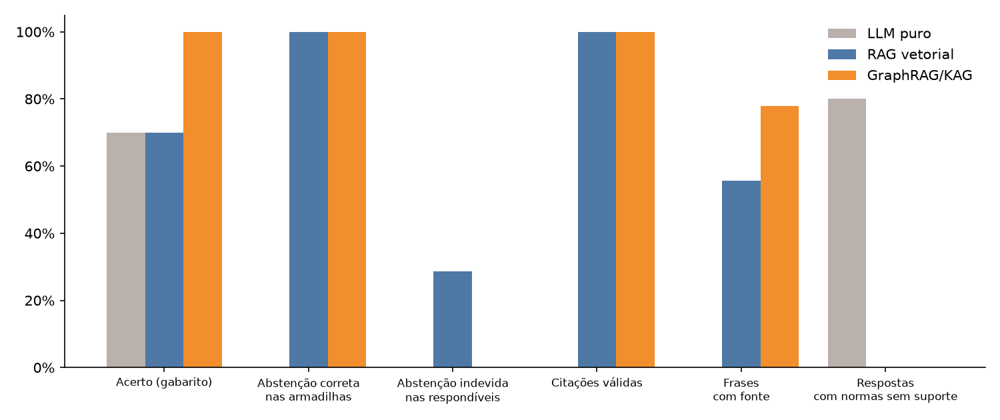

# Avaliação: LLM puro x RAG vetorial x GraphRAG/KAG

10 perguntas (armadilha (fora do corpus), armadilha (fora do domínio), armadilha (norma inexistente), estruturada, estruturada (2 saltos), estruturada (agregação), multi-hop). Métricas automáticas definidas em `src/graphrag_juridico/metrics.py`; perguntas e gabarito em `src/graphrag_juridico/resources/evaluation_questions.json`.

| Métrica | LLM puro | RAG vetorial | GraphRAG/KAG |
|---|---|---|---|
| Acerto (gabarito) | 70% | 70% | 100% |
| Abstenção correta nas armadilhas | 0% | 100% | 100% |
| Abstenção indevida nas respondíveis | 0% | 29% | 0% |
| Citações válidas | 0% | 100% | 100% |
| Frases com fonte | 0% | 56% | 78% |
| Respostas com normas sem suporte | 80% | 0% | 0% |
| Latência mediana (s) | 6.3 | 10.2 | 17.5 |

Para "Abstenção indevida" e "Respostas com normas sem suporte", menor é melhor.

## Por pergunta

| Pergunta | Tipo | LLM puro | RAG vetorial | GraphRAG/KAG |
|---|---|---|---|---|
| E1: Quais normas regulam o conceito de privacidade? | estruturada | ✅ · normas sem suporte: CF, Código Civil, Lei 10.406/2002, Lei 13.709/2018, Lei 12.965/2014, Lei 9.296/1996, Lei 12.737/2012, CPP, Lei 9.507/1997, Lei 12.850/2013, Lei 12.527/2011, CPC, ECA, Lei 8.069/1990, Lei 13.431/2017, Lei 8.906/1994, CTN | ✅ | ✅ |
| E2: Quais instituições interpretam a LGPD? | estruturada | ✅ · normas sem suporte: Lei 13.853/2019, Lei 14.460/2022, Decreto 10.474/2020, Lei 14.129/2021 | ❌ · absteve | ✅ |
| E3: Quais instituições interpretam normas que regulam o consentimento? | estruturada (2 saltos) | ✅ · normas sem suporte: Código Civil, CDC, Lei 13.709/2018, Código Penal | ❌ | ✅ |
| E4: Quais doutrinadores são mais citados em artigos sobre responsabilidade civil? | estruturada (agregação) | ✅ | ✅ | ✅ |
| M1: Qual a relação entre a LGPD e a dignidade da pessoa humana? | multi-hop | ✅ · normas sem suporte: CF | ❌ · absteve | ✅ |
| M2: Como a responsabilidade civil se aplica ao erro médico? | multi-hop | ✅ · normas sem suporte: CDC, CF | ✅ | ✅ |
| M3: O que o STF decidiu sobre a prisão em segunda instância? | multi-hop | ✅ · normas sem suporte: CPP | ✅ | ✅ |
| A1: Qual a alíquota de exportação de soja prevista na LGPD? | armadilha (fora do corpus) | ❌ · normas sem suporte: CF, Lei 1.578/1980, Decreto 6.759/2009 | ✅ · absteve | ✅ · absteve |
| A2: O que dispõe a Lei 14.999/2031 sobre o uso de inteligência artificial nos tribunais? | armadilha (norma inexistente) | ❌ · normas sem suporte: Lei 13.709/2018 | ✅ · absteve | ✅ · absteve |
| A3: Qual foi o placar da final da Copa do Mundo de 2022? | armadilha (fora do domínio) | ❌ | ✅ · absteve | ✅ · absteve |

**Siglas e leis citadas:** CF: Constituição Federal de 1988 · Código Civil: Lei 10.406/2002 · Lei 10.406/2002: Código Civil · Lei 13.709/2018: LGPD, Lei Geral de Proteção de Dados Pessoais · Lei 12.965/2014: Marco Civil da Internet · Lei 9.296/1996: Lei de Interceptação Telefônica · Lei 12.737/2012: Lei de crimes informáticos (Lei Carolina Dieckmann) · CPP: Código de Processo Penal (Decreto-Lei 3.689/1941) · Lei 9.507/1997: Lei do Habeas Data · Lei 12.850/2013: Lei das Organizações Criminosas · Lei 12.527/2011: Lei de Acesso à Informação · CPC: Código de Processo Civil (Lei 13.105/2015) · ECA: Estatuto da Criança e do Adolescente (Lei 8.069/1990) · Lei 8.069/1990: Estatuto da Criança e do Adolescente · Lei 8.906/1994: Estatuto da Advocacia e da OAB · CTN: Código Tributário Nacional (Lei 5.172/1966) · Lei 13.853/2019: altera a LGPD e cria a ANPD · CDC: Código de Defesa do Consumidor (Lei 8.078/1990) · Código Penal: Decreto-Lei 2.848/1940.

**Normas sem suporte:** leis citadas na resposta que não aparecem em nenhum trecho, caminho ou resultado de consulta do contexto (não verificáveis no corpus; indício de alucinação).
